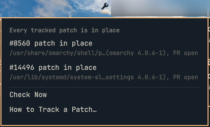

# Patchwatch

An Omarchy bar widget that tells you when an update undoes a PR patch you installed by hand, or when that PR merges.

If you test an open [Omarchy](https://github.com/omacom/omarchy) PR by copying its version of a file over the packaged one (say `/usr/share/omarchy/shell/plugins/lock/LockView.qml`), the next update silently puts the packaged file back and the bug returns. Patchwatch keeps a ledger of those patches and checks them when the shell starts, every half hour, and when you open its panel (if the last check is more than a minute old).



## What the bar shows

| Icon | Meaning |
| --- | --- |
| Bar colour | Every tracked patch is in place. |
| Dimmed | No patches tracked yet. |
| Accent colour | Something to note: a tracked PR merged and needs a re-test on your machine, or a package file was edited by hand and isn't tracked. |
| Urgent colour with a badge | An update overwrote a patch, its saved copy is missing, or the check itself failed. |

Click the icon to open the panel. Right-click rechecks.

The panel lists each finding with what to do about it. Where a fix is a single command (for example, the `sudo install` line that puts your patched file back), **Copy command** puts it on the clipboard. Patchwatch never runs `sudo` itself. **It's fine** silences a finding until it changes. **Go Through It With My Agent** opens your default agent (`omarchy agent prompt`) with a fixed prompt to work through the findings with you. If that session is still open, clicking again brings it to the front instead of starting another.

## Install

```bash
omarchy plugin add https://github.com/mudiam/omarchy-patchwatch --enable
```

Requirements: `jq` and `wl-clipboard` (both ship with Omarchy). Optional: the [GitHub CLI](https://cli.github.com/) (`gh`), signed in, to see whether a tracked PR has merged. Without it the PR state shows as unknown and everything else works.

## Track a patch

Tracking is done from a terminal with the bundled command. Give it the PR number, the package file, a copy of the patched file and, ideally, a copy of the original. Any words after that are kept as a note on how to re-test it.

```bash
P=~/.config/omarchy/plugins/io.github.mudiam.patchwatch/bin/omarchy-patchwatch

$P add 8560 /usr/share/omarchy/shell/plugins/lock/LockView.qml \
  ~/pr8560/LockView.qml ~/pr8560/LockView.qml.orig \
  "Lock, suspend, wake: the password field takes typing without a click"
```

The copies are saved under `~/.config/omarchy-patchwatch/patches/`, so the files you downloaded can go. Without the original, patchwatch can still tell that your patch is gone, but not whether the file was simply reverted or also changed upstream.

Other commands:

```bash
$P check              # the same findings as the panel, as text
$P check --json       # as JSON
$P ack <key>          # "It's fine" from the terminal
$P retire <key>       # stop tracking a patch (saved copies are kept)
$P copy-command <key> # copy a finding's command to the clipboard
```

If you'd like the command on your `PATH`, link it: `ln -s ~/.config/omarchy/plugins/io.github.mudiam.patchwatch/bin/omarchy-patchwatch ~/.local/bin/`.

## Findings

| Finding | Level | Meaning |
| --- | --- | --- |
| patch in place | ok | The live file matches your patched copy. |
| overwritten | warn | An update put the original back. The command restores your patch. |
| overwritten, file changed upstream | warn | The new packaged file differs from the one you patched, so copying your old patch back would undo upstream changes. The command shows the PR's diff to re-apply instead. |
| missing | warn | The packaged file no longer exists. |
| saved copy missing | warn | The patched copy under `~/.config/omarchy-patchwatch/patches/` is gone. |
| ledger can't be read | warn | `ledger.json` isn't a regular file of yours, is over 256 KiB, or isn't in the shape `add` writes. Nothing is checked until it's fixed. |
| PR merged and shipped | info | The fix is upstream. Re-test on your hardware, then retire it. |
| merged, patch still installed | info | The PR merged but your copy is still in place; the next update replaces it. |
| untracked local edit | info | `pacman -Qkk omarchy omarchy-settings` reports a size or checksum change to a file the ledger doesn't know about. |

Each finding uses the same shape as [omarchy-doctor](https://github.com/nixfred/omarchy-doctor) checks (`key, state, title, advice, details, command, level, signature`), so it could become a Doctor check later.

## Network, files and privileges

- **Network:** one read-only GitHub API request per tracked PR per check, made by `gh` with your existing sign-in: `GET repos/omacom/omarchy/pulls/<number>`. **It's fine** and **Copy command** run a check too, to find the finding they act on. Nothing else goes out, and nothing is ever posted.
- **Reads:** the ledger and acknowledgements below, the tracked package files, and `pacman -Qkk` / `pacman -Qo` output for the `omarchy` and `omarchy-settings` packages.
- **Writes:** only these, each replaced atomically and never written through a symlink:
  - `~/.config/omarchy-patchwatch/ledger.json` and `patches/` (when you run `add` or `retire`)
  - `~/.local/state/omarchy-patchwatch/acked.json` (when you click **It's fine**)
  - `~/.local/state/omarchy-patchwatch/notified` (only with the optional `--notify` hook below)
  - Both directories, and `patches/`, are created if missing and set to mode 0700 on every run.
- **Privileges:** none. Patchwatch never runs `sudo` or edits system files. Restore commands are shown and copied, never executed.
- **Agent:** the agent button opens your default agent with a fixed prompt. No finding text is put into the prompt; the agent runs the check itself.
- **Your config:** the plugin does not edit `shell.json`, Hyprland config or hooks.

## Removing

```bash
omarchy plugin remove io.github.mudiam.patchwatch
```

This removes the widget and the bundled command. Your patch ledger and saved copies in `~/.config/omarchy-patchwatch/` and the acknowledgements in `~/.local/state/omarchy-patchwatch/` are kept, so reinstalling picks up where you left off. Delete those two directories yourself if you don't want them. If you linked the command into `~/.local/bin`, remove that link too. If you added the optional notification hook below, delete `~/.config/omarchy/hooks/post-update.d/patchwatch.hook` as well; otherwise every update reports it as a failed hook.

## Optional: a notification after updates

The widget changes colour on its own. If you'd also like a desktop notification after `omarchy update`, add a hook that runs the check with `--notify`:

```bash
cat > ~/.config/omarchy/hooks/post-update.d/patchwatch.hook <<'EOF'
#!/bin/bash
~/.config/omarchy/plugins/io.github.mudiam.patchwatch/bin/omarchy-patchwatch check --notify >/dev/null
EOF
```

It notifies only when the set of findings changes, and clicking the notification opens your agent the same way the panel button does. Remove the hook file to turn it off.

## Background

This started as an [idea on the Omarchy discussions](https://github.com/omacom/omarchy/discussions/16333). This is the local part of it, which needs no GitHub posting.

## License

MIT
